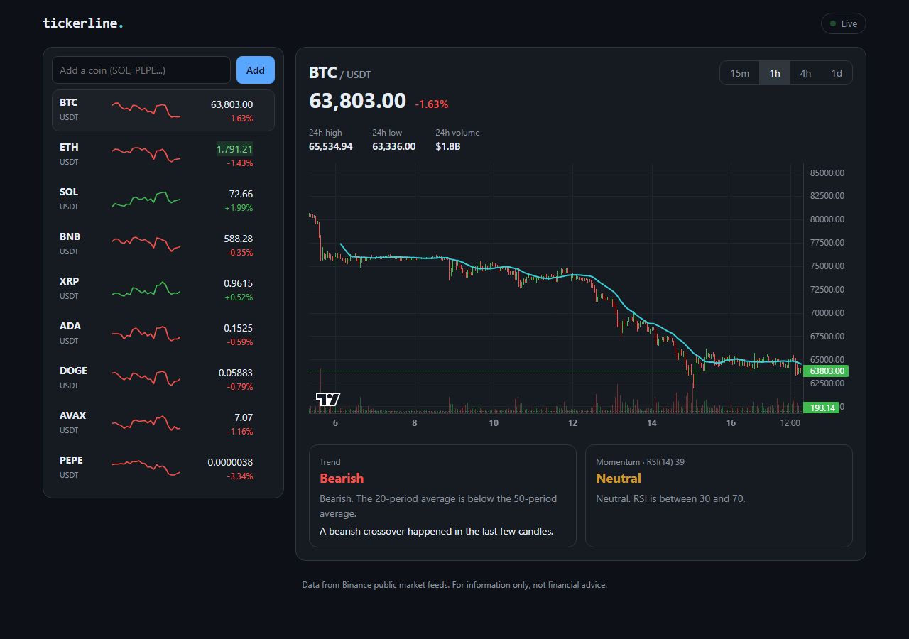
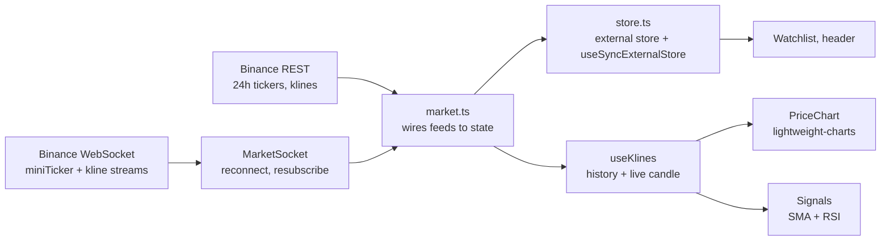

# Tickerline

A real-time crypto market dashboard. Live prices stream over a WebSocket, candlestick charts update tick by tick, and two plain, explainable indicators summarise the trend.

**Live demo: https://therealhazzard.github.io/tickerline/**



## Features

- **Live watchlist.** Prices, 24h change and a 24-hour sparkline for each coin. Each tick flashes green or red.
- **Candlestick chart.** 15m, 1h, 4h and 1d candles with volume and a 20-period moving average. The newest candle updates live.
- **Indicator signals.** Trend from a 20/50-period moving-average crossover, momentum from RSI(14). Each signal says in words why it reads the way it does.
- **Your own list.** Add any USDT pair (the symbol is checked against the exchange first) and remove the ones you do not want. The list, selection and interval are remembered in the browser.
- **A connection that looks after itself.** The WebSocket reconnects with exponential backoff, re-subscribes to every stream it had, and the header shows Live, Reconnecting or Offline.
- **Accessible controls.** Keyboard-reachable buttons with visible focus, `aria-pressed` states, a live status region, and reduced-motion support.

No API key is needed. Data comes from Binance's public, read-only market-data endpoints. Nothing is traded, nothing is stored on a server, and there is no account.

## How it works



- **State** is a small external store read with `useSyncExternalStore`, so a tick re-renders only the components that read that symbol. There is no state library.
- **The chart** loads full history once per symbol and interval, then applies only the newest candle on each tick, instead of re-setting hundreds of candles every second.
- **The indicators** (`sma`, `rsi`, `computeSignals`) are pure functions with unit tests, separate from the UI.
- **The socket** is written against a tiny interface, so its reconnect and resubscribe behaviour is tested with a fake socket and fake timers.

## Run it

```bash
npm install
npm run dev        # http://localhost:4200
npm test           # 19 unit tests
npm run build
```

## Notes and limits

- Binance's public feed can be blocked in some regions. If it is, the page says so instead of showing an empty screen.
- Signals are informational and deliberately simple. This is not financial advice.
- Candle times are shown in UTC.

## Stack

React 19 · TypeScript · Vite · TradingView Lightweight Charts · Vitest · GitHub Actions and Pages

## License

MIT
